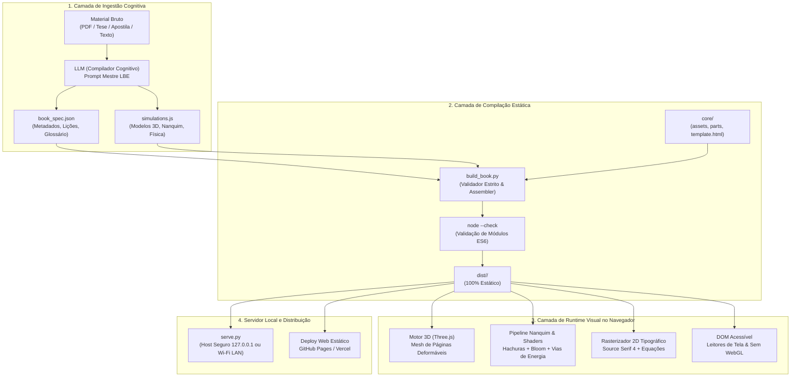
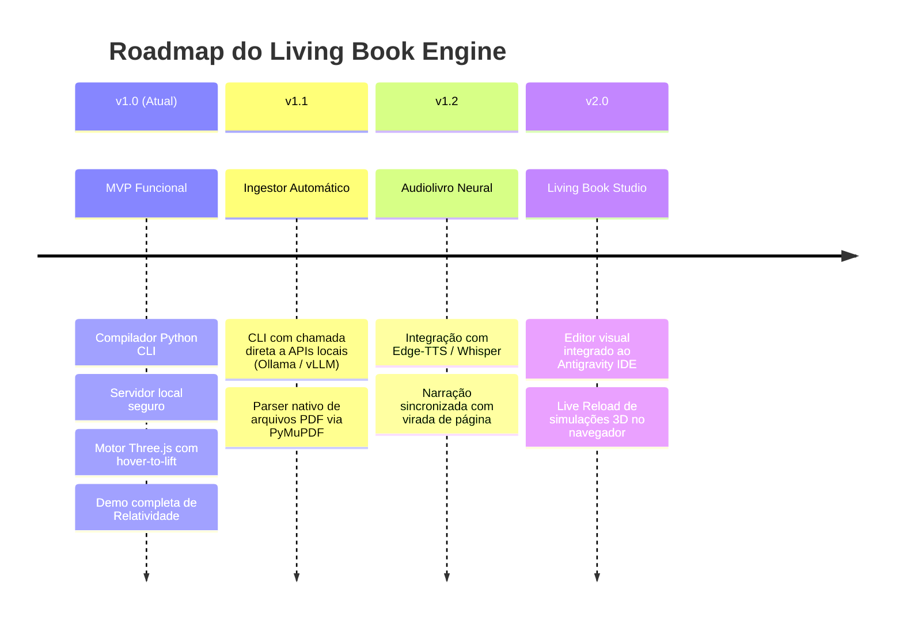

# Product Requirements Document (PRD)
## Living Book Engine (LBE) — v1.0 MVP

**Status:** Concluído & Homologado (Portão Adversary Aprovado)  
**Versão:** 1.0.0 (MVP)  
**Autoria / Engenharia:** GeniusAI & Marcio Bisognin  
**Repositório Base:** [`/data/data/com.termux/files/home/GeniusAI/living-book-engine/`](file:///data/data/com.termux/files/home/GeniusAI/living-book-engine/)  
**Licença:** MIT / Open Core  

---

## 1. Visão Executiva & Proposta de Valor

### 1.1. O Problema
Livros técnicos tradicionais, apostilas em PDF e e-books estáticos apresentam **baixa taxa de retenção cognitiva** ao explicar sistemas físicos, mecânicos ou matemáticos complexos. Plataformas interativas contemporâneas frequentemente falham pelo extremo oposto: exigem infraestrutura pesada (Node.js, Docker, empacotadores dinâmicos, servidores de banco de dados e APIs pagas), inviabilizando a distribuição offline, o consumo em dispositivos de baixo consumo (tablets, celulares, Termux) e a geração autônoma por IAs.

### 1.2. A Solução
O **Living Book Engine (LBE)** é um motor estático autônomo inspirado na arquitetura de visualização científica *Every Joule* e *O Cântico dos Quanta*. Ele opera como uma infraestrutura determinística que converte qualquer documento (PDF, artigo acadêmico, notas técnicas ou livro) em um **Livro Físico Vivo 3D** renderizado diretamente no navegador via WebGL e Three.js.

### 1.3. Pilares Centrais
1. **The Object is the Explanation:** O conceito técnico não é representado por diagramas abstratos (caixas e setas soltas), mas corporificado fisicamente como uma máquina, aparato ou instrumento real.
2. **Elevação Tridimensional (Hover-to-Lift):** A ilustração repousa na página como uma gravura antiga impressa em nanquim com hachuras arquitetônicas. Ao toque ou interação do ponteiro, ela se ergue da folha no espaço tridimensional e torna-se um experimento vivo.
3. **Zero Dependências em Produção:** O bundle compilado é 100% estático (HTML5, ES6 Modules, shaders glTF e fontes WOFF2). Roda diretamente via qualquer servidor HTTP simples (`python3 -m http.server`) ou hospedagem estática (GitHub Pages, Netlify, Vercel).
4. **Ingestão Universal por IAs:** Qualquer LLM moderna (Claude 3.7, ChatGPT o3/4o, DeepSeek R1, Gemini ou Llama local) atua como **Compilador Cognitivo**, consumindo material bruto e devolvendo apenas dois artefatos rigorosamente tipados: `book_spec.json` e `simulations.js`.

---

## 2. Topologia e Arquitetura do Sistema



### 2.1. Decomposição Modular do Motor

| Módulo | Localização | Papel Técnico |
| :--- | :--- | :--- |
| **CLI Compiler** | [`compiler/build_book.py`](file:///data/data/com.termux/files/home/GeniusAI/living-book-engine/compiler/build_book.py) | Validação de schema, cálculo dinâmico de métricas de spreads, injeção de imports ES6 e empacotamento |
| **Local Server** | [`compiler/serve.py`](file:///data/data/com.termux/files/home/GeniusAI/living-book-engine/compiler/serve.py) | Servidor HTTP de baixa latência, CORS irrestrito, Cache-Control desativado e bind seguro |
| **Core Template** | [`core/template.html`](file:///data/data/com.termux/files/home/GeniusAI/living-book-engine/core/template.html) | Shell HTML com animação procedural de abertura, detecção WebGL e failsafe |
| **Lexical Parts** | [`core/parts/`](file:///data/data/com.termux/files/home/GeniusAI/living-book-engine/core/parts/) | Fragmentos base (`content-prefix.js`, `content-bridge.js`, `content-suffix.js`, `sims-prefix.js`) |
| **Core Vendor** | [`core/assets/`](file:///data/data/com.termux/files/home/GeniusAI/living-book-engine/core/assets/) | Three.js otimizado, renderizador de pós-processamento, shaders de nanquim e fontes WOFF2 |

---

## 3. Requisitos Funcionais (RF)

### RF01: Ingestão de Conteúdo e Decomposição Atômica
* O sistema deve aceitar a transcrição ou o conteúdo textual integral de qualquer documento técnico.
* O conteúdo deve ser decomposto em uma sequência de **4 a 10 lições atômicas e progressivas**, cada uma contendo: contextualização narrativa, mecanismo matemático formal, glossário vinculado, predição ativa, aba expansível e desafio de fixação.

### RF02: Física Realista de Virada de Página (Book Physics)
* O motor deve renderizar uma geometria de livro duplo aberta no espaço 3D usando malhas curvas dinâmicas (`PlaneGeometry` deformada proceduralmente via funções hermite/spline).
* Suporte a múltiplos métodos de navegação:
  - Teclado: Setas <kbd>→</kbd> e <kbd>←</kbd> avançam e retrocedem spreads.
  - Ponteiro/Mouse: Clique na borda da folha aciona a animação de curvatura com sombreamento volumétrico.
  - Toque (Touchscreen): Suporte nativo a gestos de arraste (*swipe*) com inércia física.

### RF03: Ilustrações com Elevação Tridimensional (Hover-to-Lift)
* No estado em repouso (`print`), a ilustração da página direita deve exibir aspecto de gravura impressa no papel com nanquim preto sobre fundo sépia, gerada por projeção ortográfica e sombreamento de hachuras (`cross-hatching`).
* No estado ativo (`live`), o aparato deve erguer-se no eixo vertical (Z/Y), projetando sombras no papel e ativando shaders de brilho (*bloom*), fontes de luz dinâmicas e malhas interativas via raycaster.

### RF04: Validação Estrita Anti-Crash para IAs (`validate_spec`)
O compilador Python deve barrar preventivamente alucinações comuns de LLMs:
* `equation`: Rejeitar strings planas; exigir obrigatoriamente `{ symbols: string, words: string }`.
* `challenge`: Rejeitar strings planas; exigir obrigatoriamente `{ text: string }`.
* `keywords`: Exigir array de objetos contendo `{ term: string, definition: string }`.
* `glossary`: Exigir array de objetos contendo `id`, `term`, e a lista numérica de lições associadas `lessons: [int, ...]`.
* `predict`: Exigir objeto contendo `question: string` e lista de alternativas `options: [string, ...]`.

### RF05: Reindexação Dinâmica de Spreads e Back Matter
O compilador deve recalcular e injetar dinamicamente no código-fonte do motor Three.js:
* O número total de spreads: $\text{total\_spreads} = N_{\text{lições}} + 4$ (Capa, Sumário, Lições, Índice, Quiz, Fontes).
* Reindexação dos marcadores de leitura (`Continue at lesson X`), links do sumário no canvas 2D e barra acessível.
* Geração do mapa de imports dinâmicos `qo` para carregar apenas as simulações da lição em foco.

### RF06: Servidor Local Seguro e Acesso Wi-Fi
* Bind padrão restrito a `127.0.0.1` para garantir segurança em redes corporativas ou compartilhadas.
* Flag `--network` que altera o bind para `0.0.0.0`, identifica automaticamente o IP da placa Wi-Fi local e exibe no terminal o link formatado para testes em smartphones e tablets.
* Tabela de MIME Types completa cobrindo `.js`, `.mjs`, `.woff2`, `.css`, `.html`, `.json`, `.svg`, `.glb`, `.gltf`, `.webp`, `.png`, `.jpg`, `.mp3` e `.wav`.

---

## 4. Requisitos Não-Funcionais (RNF)

| Identificador | Requisito | Métrica Alvo |
| :--- | :--- | :--- |
| **RNF01: Desempenho** | Taxa de quadros no desktop e mobile | 60 FPS estáveis em desktops; mínimo de 30 FPS em dispositivos móveis sob degradação dinâmica de tiers (`high`, `medium`, `low`) |
| **RNF02: Pegada Estática** | Dependência de runtime do produto gerado | Zero dependência de Node.js, npm, Webpack, Vite ou backend em tempo de execução |
| **RNF03: Tempo de Build** | Duração da compilação pelo script Python | Inferior a 2,0 segundos para livros de até 10 lições |
| **RNF04: Fidelidade Tipográfica** | Renderização do texto no canvas | Fonte *Source Serif 4 Variable* renderizada em alta densidade com resolução subpixel |
| **RNF05: Acessibilidade** | Suporte a leitores de tela e usuários sem GPU | DOM espelhado em `#sheet` e painel alternativo `#a11y` para conformidade com navegadores sem WebGL |

---

## 5. Especificação Técnica dos Contratos

### 5.1. Contrato `book_spec.json`
```json
{
  "$schema": "http://json-schema.org/draft-07/schema#",
  "title": "LivingBookSpec",
  "type": "object",
  "required": ["title", "lessons"],
  "properties": {
    "title": { "type": "string" },
    "subtitle": { "type": "string" },
    "author": { "type": "string" },
    "lang": { "type": "string", "default": "pt-BR" },
    "description": { "type": "string" },
    "copyright": { "type": "string" },
    "presentation": { "type": "string", "default": "apresenta" },
    "brand": { "type": "string", "default": "Techartist" },
    "glossary": {
      "type": "array",
      "items": {
        "type": "object",
        "required": ["id", "term", "lessons"],
        "properties": {
          "id": { "type": "string" },
          "term": { "type": "string" },
          "label": { "type": "string" },
          "lessons": { "type": "array", "items": { "type": "integer" } },
          "definition": { "type": "string" },
          "short": { "type": "string" }
        }
      }
    },
    "lessons": {
      "type": "array",
      "minItems": 1,
      "items": {
        "type": "object",
        "required": ["title", "explanation", "equation", "keywords", "predict", "explain", "tryHint", "challenge"],
        "properties": {
          "n": { "type": "integer" },
          "title": { "type": "string" },
          "runningHead": { "type": "string" },
          "figure": { "type": "string" },
          "explanation": { "type": "array", "items": { "type": "string" } },
          "equation": {
            "type": "object",
            "required": ["symbols", "words"],
            "properties": {
              "symbols": { "type": "string" },
              "words": { "type": "string" }
            }
          },
          "keywords": {
            "type": "array",
            "items": {
              "type": "object",
              "required": ["term", "definition"],
              "properties": {
                "term": { "type": "string" },
                "definition": { "type": "string" }
              }
            }
          },
          "predict": {
            "type": "object",
            "required": ["question", "options"],
            "properties": {
              "question": { "type": "string" },
              "options": { "type": "array", "items": { "type": "string" } }
            }
          },
          "explain": { "type": "string" },
          "tryHint": { "type": "string" },
          "challenge": {
            "type": "object",
            "required": ["text"],
            "properties": {
              "text": { "type": "string" }
            }
          }
        }
      }
    }
  }
}
```

### 5.2. Contrato `simulations.js` (Interface ES6)
Cada lição $i$ deve exportar uma função no formato:
```typescript
interface LessonSimulation {
  state: Record<string, any>;
  glowObjects?: () => THREE.Object3D[];
  lightSources?: () => any[];
  targets?: () => THREE.Object3D[];
  onPointerDown?: (target: THREE.Object3D) => void;
  onPointerMove?: (target: THREE.Object3D) => void;
  onPointerUp?: () => void;
  challenge?: () => { met: boolean; text?: string };
  margin?: () => Array<{ text: string }>;
  update: (dt: number, camera: THREE.Camera, isLive: boolean, opts?: any) => void;
  leave?: () => void;
}

type BuildLessonFn = (stage: StageContext, env?: any) => LessonSimulation;
```

---

## 6. Procedimento de Testes e Homologação

Para aprovação de qualquer build compilado pelo LBE, os seguintes testes unitários e de integração são executados compulsoriamente:

1. **Validação Estática da AST:**
   `node --check dist/<livro>/assets/index-quanta.js`
   `node --check dist/<livro>/assets/sims-quanta.js`
   `node --check dist/<livro>/assets/main-quanta.js`
2. **Avaliação Semântica em Tempo de Execução (Runtime Node.js Test):**
   Execução de import dinâmico em ambiente isolado para garantir que nenhuma dependência global (`x`, `_`, `document`, `window`) lance `ReferenceError` na inicialização do módulo.
3. **Inspeção de Contratos e Spreads:**
   Verificação de que $jr = N + 4$ e que os índices de navegação (`Index`, `Quiz`, `Sources`) apontam exatamente para os spreads calculados.
4. **Auditoria de Rede e MIME Types:**
   Verificação via requisição HTTP (`curl -I`) confirmando cabeçalhos `HTTP/1.0 200 OK`, `Content-type: application/javascript; charset=utf-8`, `Cache-Control: no-cache` e suporte a CORS.

---

## 7. Roadmap de Evolução


